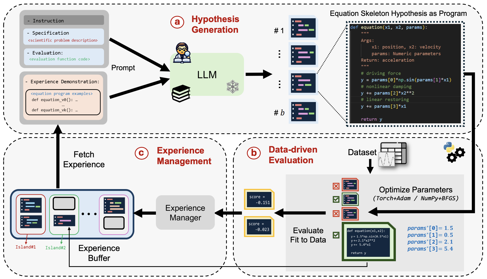

# LLMSR: LLM-based Symbolic Regression (Scientific Equation Discovery)

<div align="center">



**Scientific equation discovery with Large Language Models (LLMs) and multi-island evolutionary search, built on SDE-Harness.**

[](https://www.python.org/downloads/)
[](https://opensource.org/licenses/MIT)
[](https://github.com/HowieHwong/sde-harness)

</div>

This project implements [LLM-SR](https://arxiv.org/abs/2404.18400) on top of SDE-Harness. The search loop, prompts,
experience buffer, fitness evaluation and test metrics follow the original LLM-SR implementation used for the
LLM-SRBench / SDE-Harness paper results.

## Method

- **Equation skeletons as programs**: the LLM writes a Python `equation(..., params)` function; up to 10 constants
  `params` are fitted with BFGS (initialized at 1.0) on the training data.
- **Fitness**: negative training MSE of the fitted skeleton. Each sample is executed in a separate process with a
  timeout (30 s by default).
- **Prompts**: each prompt shows `functions_per_prompt` (2) previous skeletons from one island as `equation_v0`,
  `equation_v1`, ... sorted by score, and asks the LLM to complete `equation_v2`.
- **Multi-island experience buffer**: 10 islands; inside an island, programs are clustered by score and clusters are
  sampled with an annealed softmax (shorter programs are preferred within a cluster); the weaker half of the islands
  is periodically reset from the best islands.
- **Budget**: 1000 LLM samples per problem, 8 samples per prompt drawn concurrently.
- **Final evaluation**: the best skeleton is re-fitted on the training data and evaluated on the in-domain (ID) and
  out-of-domain (OOD) test sets with NMSE, R², Kendall τ, MAPE and Acc<sub>τ</sub> (τ = 0.1, 0.01, 0.001; a problem
  counts as solved when at least 95% of test points satisfy |ŷ − y| ≤ τ·|y|).

## Structure

```
llmsr/
├── src/
│   ├── core/
│   │   ├── generation.py         # LLMSRGeneration - LLM sampling (SDE-Harness Generation)
│   │   ├── oracle.py             # EquationOracle - sandboxed fitness evaluation + test metrics
│   │   ├── prompt.py             # Specification / evaluation programs and instruction prompt
│   │   ├── buffer.py             # Multi-island experience buffer
│   │   └── code_manipulation.py  # Program parsing / rendering utilities
│   └── modes/
│       └── evol.py               # LLMSREvolutionaryWorkflow - LLM-SR search loop
├── data/
│   └── dataset.py                # LLMSRDatasetLoader - LLM-SRBench (HuggingFace) loader
├── cli.py                        # Command-line interface
└── requirements.txt
```

## Datasets

[LLM-SRBench](https://huggingface.co/datasets/nnheui/llm-srbench) datasets (downloaded automatically):

- **`lsrtransform`**: transformed Feynman equations
- **`phys_osc`**: nonlinear oscillators (LSR-Synth)
- **`bio_pop_growth`**: population growth (LSR-Synth)
- **`chem_react`**: chemical reaction kinetics (LSR-Synth)
- **`matsci`**: materials science (LSR-Synth)

By default the output-variable descriptions used in the prompts match the paper runs (they differ slightly from the
HuggingFace metadata for `phys_osc` and `bio_pop_growth`); pass `--hf-descriptions` to use the HuggingFace ones.

## Quick Start

### Installation

```bash
# From the sde-harness repository root
pip install -e .
pip install -r projects/llmsr/requirements.txt
```

### API credentials

Models and credentials are read from the SDE-Harness `config/` directory (override with `--models-file` and
`--credentials-file`):

```bash
cp config/models.template.yaml config/models.yaml
cp config/credentials.template.yaml config/credentials.yaml   # then add your API keys
```

`config/models.template.yaml` already contains the models used in the paper: `openai/gpt-5`, `openai/gpt-5-chat`,
`anthropic/claude-sonnet-4.5` and `deepseek/deepseek-R1`. Request settings follow the paper runs: provider-default
sampling temperature, `reasoning_effort="medium"` for GPT-5 and `max_tokens=16000` for Claude.

### Example runs

```bash
cd projects/llmsr

# One problem
python cli.py --dataset phys_osc --problem PO0 --model openai/gpt-5 --output-dir outputs/phys_osc_gpt5

# Whole dataset (already finished problems in <output-dir>/results.jsonl are skipped, so runs can be resumed)
python cli.py --dataset phys_osc --model anthropic/claude-sonnet-4.5 --output-dir outputs/phys_osc_claude45

# Subset of problems
python cli.py --dataset bio_pop_growth --problem-filter BPG0 BPG1 --model deepseek/deepseek-R1
```

The defaults reproduce the paper setting (`--max-samples 1000 --samples-per-prompt 8 --num-islands 10
--functions-per-prompt 2`). Run `python cli.py --help` for all options.

### Outputs

- `<output-dir>/results.jsonl`: one line per problem with the best program, fitted parameters, best training score,
  and `id_metrics` / `ood_metrics` (`mse`, `nmse`, `r2`, `kdt`, `mape`, `acc_0.1`, `acc_0.01`, `acc_0.001`,
  `num_valid_points`).
- `<output-dir>/<problem>/samples.jsonl`: every evaluated sample with its score and the running best score.
- `<output-dir>/<problem>/result.json`: the result of that problem.

## Citation
<pre>
@article{llmsr,
  title={Llm-sr: Scientific equation discovery via programming with large language models},
  author={Shojaee, Parshin and Meidani, Kazem and Gupta, Shashank and Farimani, Amir Barati and Reddy, Chandan K},
  journal={arXiv preprint arXiv:2404.18400},
  year={2024}
}

@article{shojaee2025llm,
  title={Llm-srbench: A new benchmark for scientific equation discovery with large language models},
  author={Shojaee, Parshin and Nguyen, Ngoc-Hieu and Meidani, Kazem and Farimani, Amir Barati and Doan, Khoa D and Reddy, Chandan K},
  journal={arXiv preprint arXiv:2504.10415},
  year={2025}
}
</pre>
